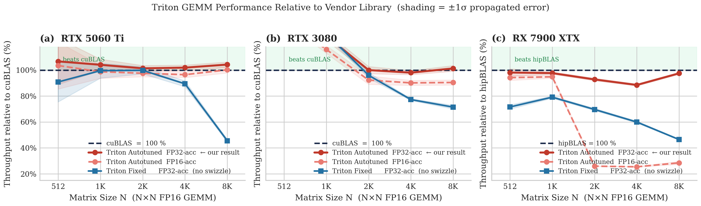
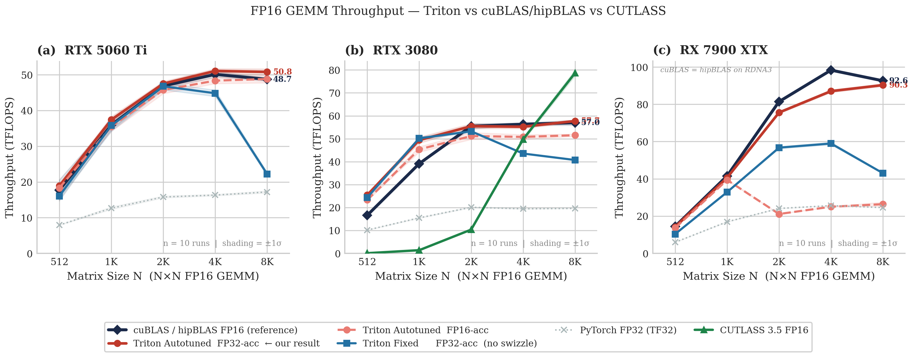
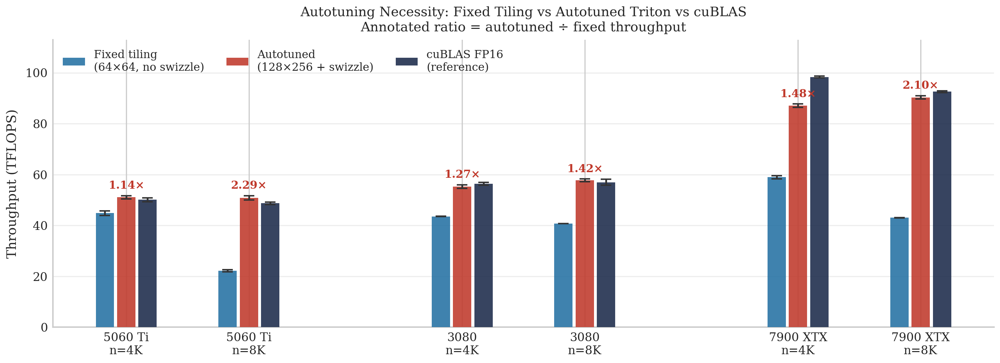

<h1 align="center">Triton FP16 GEMM</h1>

<p align="center">
  <b>A from-scratch FP16 matrix-multiplication kernel in OpenAI Triton that reaches vendor-BLAS throughput on NVIDIA Blackwell, NVIDIA Ampere and AMD RDNA3 from a single source file.</b>
</p>

<p align="center">
  
  
  
  
  
</p>

---

## Highlights

- **Vendor-level performance from a ~60-line kernel.** The autotuned kernel lands within ±5 % of cuBLAS / rocBLAS at N = 8192 on all three GPUs and beats cuBLAS outright on the RTX 5060 Ti.
- **Portable by construction.** The same kernel source runs unmodified on CUDA and ROCm; the autotuner picks a different tile shape, warp count and pipeline depth per architecture.
- **Switchable accumulator.** A single `constexpr` flag selects FP32 or FP16 accumulation, which makes the precision/throughput trade-off measurable instead of assumed.
- **Reproducible, statistically honest benchmarks.** Every number below is the mean of 10 independent process launches, with ±1σ bands, raw CSVs, per-run logs and environment metadata committed to the repo.
- **A five-step ablation** isolates which optimisation actually matters: software pipelining, not tile size or L2 swizzling, is what unlocks large tiles.

## Results at a glance

Autotuned Triton kernel (FP32 accumulator) versus the vendor FP16 GEMM at N = 8192. Mean ± σ over 10 runs.

| GPU | Architecture | Triton (TFLOPS) | Vendor BLAS (TFLOPS) | Triton / vendor | Speed-up over fixed 64×64 tiles |
|---|---|---:|---:|---:|---:|
| RTX 5060 Ti 16 GB | Blackwell | **50.8 ± 0.8** | 48.7 ± 0.5 (cuBLAS) | **104 %** | 2.29× |
| RTX 3080 10 GB | Ampere | **57.7 ± 0.5** | 57.0 ± 1.1 (cuBLAS) | **101 %** | 1.42× |
| RX 7900 XTX 24 GB | RDNA3 | **90.3 ± 0.7** | 92.6 ± 0.4 (rocBLAS) | **98 %** | 2.10× |

<p align="center">
  
</p>

## How the kernel works

Both kernels live in [`kernels/triton_gemm.py`](kernels/triton_gemm.py) and compute `C = A @ B` for row-major FP16 matrices of any shape.

| Technique | What it does | Where |
|---|---|---|
| **Blocked tiling** | Each program instance computes one `BLOCK_M × BLOCK_N` tile of C, streaming over K in `BLOCK_K` slices and feeding `tl.dot` (tensor cores / WMMA). | both kernels |
| **Masked boundary loads** | Out-of-range rows and columns are masked to zero, so shapes that are not a multiple of the tile (e.g. 127 × 91 @ 91 × 193) are handled without padding. | both kernels |
| **Switchable accumulator** | `USE_FP32_ACC` is a compile-time `constexpr`; the FP16 path downcasts each partial `tl.dot` before accumulating. | both kernels |
| **Grouped tile ordering (L2 swizzle)** | A 1-D launch grid is remapped so `GROUP_M` consecutive row-blocks of A are processed together, keeping the working set of B resident in L2. | autotuned kernel |
| **Software pipelining** | `num_stages` controls how many `BLOCK_K` slices are prefetched into shared memory ahead of the compute loop. | autotuned kernel |
| **Autotuning** | 192 configurations of `BLOCK_M, BLOCK_N ∈ {64, 128, 256}`, `BLOCK_K ∈ {32, 64}`, `GROUP_M ∈ {4, 8}`, `num_warps ∈ {4, 8}`, `num_stages ∈ {2, 3, 4}`, keyed on `(M, N, K)` and cached after the first call. | autotuned kernel |

The fixed-tile kernel (default 64 × 64 × 32, plain 2-D grid, no swizzle) is kept as a baseline so that the effect of each optimisation can be measured.

Configurations the autotuner settled on most often at N = 8192 (FP32 accumulator):

| GPU | Tile (M × N × K) | `GROUP_M` | Warps | Stages |
|---|---|---:|---:|---:|
| RTX 5060 Ti | 128 × 128 × 32 | 4 / 8 | 4 | 4 |
| RTX 3080 | 128 × 256 × 32 | 4 | 8 | 3 |
| RX 7900 XTX | 128 × 256 × 32 | 8 | 8 | 2 |

## Installation

```bash
git clone https://github.com/armaanamatya/GEMM.git
cd GEMM

# 1. Install PyTorch for your GPU first (pick the CUDA or ROCm wheel from https://pytorch.org/get-started/locally/)
#    NVIDIA example:
pip install torch --index-url https://download.pytorch.org/whl/cu128
#    AMD example:
pip install torch --index-url https://download.pytorch.org/whl/rocm6.2

# 2. Install Triton (already bundled with recent CUDA wheels of PyTorch)
pip install -r requirements.txt
```

Requirements: Python 3.10+, PyTorch 2.5+, Triton 3.0+ (3.2+ on Blackwell), and an NVIDIA (CUDA 12.x) or AMD (ROCm 6.x) GPU.

Verify the install by running the correctness suite, which checks both kernels and both accumulator modes against `torch.matmul` on square and non-aligned shapes:

```bash
python tests/test_correctness.py
```

## Usage

Run from the repository root (or add it to `PYTHONPATH`).

```python
import torch
from kernels import triton_matmul, triton_matmul_autotune, get_autotune_best_config

a = torch.randn(4096, 4096, device="cuda", dtype=torch.float16)
b = torch.randn(4096, 4096, device="cuda", dtype=torch.float16)

# Fixed 64x64x32 tiles, FP32 accumulator (default)
c = triton_matmul(a, b)

# Same kernel with an FP16 accumulator
c_fp16 = triton_matmul(a, b, use_fp32_acc=False)

# Pick your own tile shape
c = triton_matmul(a, b, block_m=128, block_n=128, block_k=32)

# Autotuned kernel: the first call for a given (M, N, K) runs the 192-config search, later calls are free
c = triton_matmul_autotune(a, b)

# Inspect the winning configuration
print(get_autotune_best_config(a, b))
# {'BLOCK_M': 128, 'BLOCK_N': 256, 'BLOCK_K': 32, 'GROUP_M': 4, 'num_warps': 8, 'num_stages': 3}

torch.testing.assert_close(c, a @ b, atol=1e-2, rtol=1e-2)
```

Non-square and non-tile-aligned shapes work the same way thanks to masked loads:

```python
a = torch.randn(127, 91, device="cuda", dtype=torch.float16)
b = torch.randn(91, 193, device="cuda", dtype=torch.float16)
c = triton_matmul_autotune(a, b)          # shape (127, 193)
```

Inputs must be 2-D, contiguous, FP16 tensors on the GPU; the wrappers raise a `ValueError` otherwise.

## Reproducing the benchmarks

Every script accepts `--warmup` and `--rep` (defaults 25 / 100) and runs the five sizes N ∈ {512, 1024, 2048, 4096, 8192}.

| Command | What it measures |
|---|---|
| `python benchmarks/run_all.py --gpu-name <label> --run-id 01 --output-dir <dir>` | Full comparison: cuBLAS/rocBLAS FP16, PyTorch FP32 (TF32), Triton fixed and autotuned in both accumulator modes, and CUTLASS 3.5 when `nvidia-cutlass` is installed. Writes `results.csv`, `meta.json` and `run.log`. Add `--amd` on ROCm or `--no-cutlass` to skip CUTLASS. |
| `python benchmarks/ablation.py --output-dir <dir>` | The V1 to V5 ablation (naive tiles → large tiles → +swizzle → +pipeline → autotune) against cuBLAS. |
| `python benchmarks/bench_gemm_sweep.py --csv out.csv` | Fixed-tile kernel, FP32 vs FP16 accumulator, vs cuBLAS. |
| `python benchmarks/bench_autotune_sweep.py --csv out.csv` | Autotuned vs fixed vs cuBLAS, with the best config per size. |
| `python benchmarks/profile_ncu.py --mode triton_fp32 --n 4096` | Single launch for Nsight Compute, e.g. `ncu --set full python benchmarks/profile_ncu.py --mode triton_fp32`. |
| `python benchmarks/generate_plots.py` | Regenerates every figure in `benchmarks/results/plots/` from the committed CSVs. |

To reproduce the 10-run protocol used for every number in this README:

```bash
# Main benchmark, 10 independent processes (fresh autotune cache each time).
# generate_plots.py expects the labels 5060ti, 3080 and amd.
for i in $(seq -f "%02g" 1 10); do
  python benchmarks/run_all.py --gpu-name 5060ti --run-id "$i" \
         --output-dir "benchmarks/results/10x5060ti/run_$i"
done

# Ablation, 10 runs (bash on Linux/WSL, PowerShell on Windows)
bash 10xablation5060ti.sh
.\10xablation5060ti.ps1

python benchmarks/generate_plots.py
```

## Detailed results

### Throughput relative to vendor BLAS

Autotuned kernel, FP32 accumulator, as a percentage of cuBLAS (NVIDIA) or rocBLAS (AMD). Mean over 10 runs.

| N | RTX 5060 Ti | RTX 3080 | RX 7900 XTX |
|---:|---:|---:|---:|
| 512 | 107 % | 153 % | 98 % |
| 1024 | 104 % | 126 % | 98 % |
| 2048 | 101 % | 100 % | 93 % |
| 4096 | 102 % | 98 % | 89 % |
| 8192 | 104 % | 101 % | 98 % |

The fixed 64 × 64 × 32 kernel matches the vendor library up to N = 2048 but falls to 45.5 % (5060 Ti), 71.5 % (3080) and 46.5 % (7900 XTX) at N = 8192 once the problem outgrows L2.

<p align="center">
  
</p>

### Ablation: which optimisation matters?

Each variant adds one change on top of the previous one. TFLOPS at N = 8192, mean over 10 runs, with the ratio to the vendor library in parentheses.

| Variant | Change | RTX 5060 Ti | RTX 3080 | RX 7900 XTX |
|---|---|---:|---:|---:|
| V1 | 64 × 64 tiles, 2-D grid, 2 stages | 22.2 (46 %) | 40.7 (69 %) | 43.0 (46 %) |
| V2 | 128 × 256 tiles | 21.6 (44 %) | 4.7 (8 %) | 12.7 (14 %) |
| V3 | + grouped tile ordering (L2 swizzle) | 21.8 (45 %) | 5.1 (9 %) | 13.4 (14 %) |
| V4 | + 3-stage pipeline, 8 warps | 48.8 (100 %) | 59.0 (100 %) | 80.9 (86 %) |
| V5 | + full autotune | **50.7 (104 %)** | **57.6 (98 %)** | **88.9 (95 %)** |
| | Vendor BLAS | 48.6 | 58.9 | 93.7 |

<p align="center">
  
</p>

### Accumulator precision

Autotuned kernel at N = 8192, as a percentage of the vendor library.

| Accumulator | RTX 5060 Ti | RTX 3080 | RX 7900 XTX | Max abs error tolerance in tests |
|---|---:|---:|---:|---|
| FP32 | 104 % | 101 % | 98 % | 1e-2 |
| FP16 | 100 % | 91 % | 29 % | 4.0 to 5.0 |

### Key findings

1. **Autotuning is not optional.** A single hand-picked tile shape is competitive only for small problems. Letting the autotuner choose recovers 1.4× to 2.3× at N = 8192, and the best configuration differs on every GPU.
2. **Large tiles are useless without pipelining.** Going from 64 × 64 to 128 × 256 tiles alone *drops* throughput by up to 9× at N = 8192 (V2), and adding L2 swizzling on top changes nothing (V3). Deepening the software pipeline to three stages with eight warps (V4) is the single step that turns the large tile into a win, reaching parity with cuBLAS on both NVIDIA cards.
3. **FP16 accumulation buys nothing and costs accuracy.** `tl.dot` already produces an FP32 result on tensor cores, so the FP16 path only adds a downcast per K-slice. It is 4 to 10 points slower on NVIDIA, collapses to 29 % of rocBLAS on RDNA3, and needs a tolerance 400× looser to pass the correctness tests.
4. **The same source is portable across vendors.** With no code changes the kernel reaches 98 % of rocBLAS on the RX 7900 XTX, where the autotuner prefers two pipeline stages instead of the three or four chosen on NVIDIA.
5. **Baselines have their own quirks.** Triton is 26 to 53 % faster than cuBLAS for N ≤ 1024 on the RTX 3080, and the CUTLASS 3.5 Python bindings reach 138 % of cuBLAS at N = 8192 on the same card while performing poorly below N = 4096 in this harness (see `fig4_cutlass_ramp.png`).

## Methodology

- **Workload.** Square FP16 GEMM, `C[N×N] = A[N×K] · B[K×N]` with M = N = K, inputs drawn from a seeded standard normal distribution.
- **Timing.** `triton.testing.do_bench` with 25 warm-up and 100 timed iterations, reporting the median kernel time. Throughput is `2·N³ / t`.
- **Repetition.** Each GPU was benchmarked in 10 independent process launches, so every run includes a cold autotune. Tables report the mean; figures shade ±1σ.
- **Baselines.** `torch.matmul` on FP16 tensors (cuBLAS on CUDA, rocBLAS/hipBLAS on ROCm), `torch.matmul` on FP32 tensors (TF32), and the `nvidia-cutlass` Python package on the RTX 3080.
- **Provenance.** Every run directory under `benchmarks/results/` contains `results.csv`, `meta.json` (device, VRAM, CUDA/ROCm, PyTorch and Python versions, timestamps) and the full `run.log`.

### Hardware and software

| GPU | Architecture | VRAM | Platform | Driver stack | PyTorch | Triton | Python |
|---|---|---:|---|---|---|---|---|
| NVIDIA RTX 5060 Ti | Blackwell | 16 GB | Linux (WSL2) | CUDA 12.8 | 2.11.0+cu128 | 3.2.0 | 3.13 |
| NVIDIA RTX 3080 | Ampere | 10 GB | Linux | CUDA 12.6 | 2.6.0+cu126 | 3.0.0 | 3.10 |
| AMD RX 7900 XTX | RDNA3 | 24 GB | Linux | ROCm 6.2 | 2.5.1+rocm6.2 | 3.0.0 | 3.12 |

## Repository layout

```
GEMM/
├── kernels/
│   ├── triton_gemm.py        # fixed-tile and autotuned Triton kernels + Python wrappers
│   ├── baseline_pytorch.py   # torch.matmul reference and test-case generator
│   └── __init__.py
├── tests/
│   └── test_correctness.py   # both kernels, both accumulators, square and ragged shapes
├── benchmarks/
│   ├── run_all.py            # unified multi-backend runner (CSV + JSON metadata + log)
│   ├── ablation.py           # V1-V5 ablation study
│   ├── bench_gemm_sweep.py   # fixed-tile sweep
│   ├── bench_autotune_sweep.py
│   ├── profile_ncu.py        # Nsight Compute entry point
│   ├── generate_plots.py     # figures from the committed CSVs
│   └── results/
│       ├── 10x5060ti/ 10x3080/ 10xamd/            # main benchmark, 10 runs each
│       ├── 10xablation5060ti/ 10xablation3080/ 10xablationamd/
│       └── plots/                                 # fig1-fig4 (PNG + PDF), summary tables
├── 10xablation*.sh / .ps1    # 10-run ablation harnesses (Linux/WSL and Windows)
└── requirements.txt
```

## Debugging

```bash
# Run the kernels on the CPU interpreter for line-by-line debugging
TRITON_INTERPRET=1 python tests/test_correctness.py

# Check for out-of-bounds accesses and races (NVIDIA)
compute-sanitizer python tests/test_correctness.py

# Kernel-level profile (NVIDIA)
ncu --set full python benchmarks/profile_ncu.py --mode triton_fp32 --n 4096
```

## Limitations

- FP16 inputs only; BF16, FP8 and TF32 paths are not implemented.
- Inputs must be contiguous row-major 2-D tensors; batched GEMM, transposed operands and epilogue fusion (bias, activation) are out of scope.
- The autotuner searches 192 configurations on the first call for each new `(M, N, K)`, which takes tens of seconds per shape. Production use should pin the winning config or persist the cache.
- Benchmarks cover square problems; skinny or tall matrices will favour different tile shapes.

## Acknowledgements

Developed by Armaan Amatya as the final project for COSC 4397. Built on [OpenAI Triton](https://github.com/triton-lang/triton) and [PyTorch](https://pytorch.org/); the grouped tile-ordering scheme follows the Triton matrix-multiplication tutorial.
